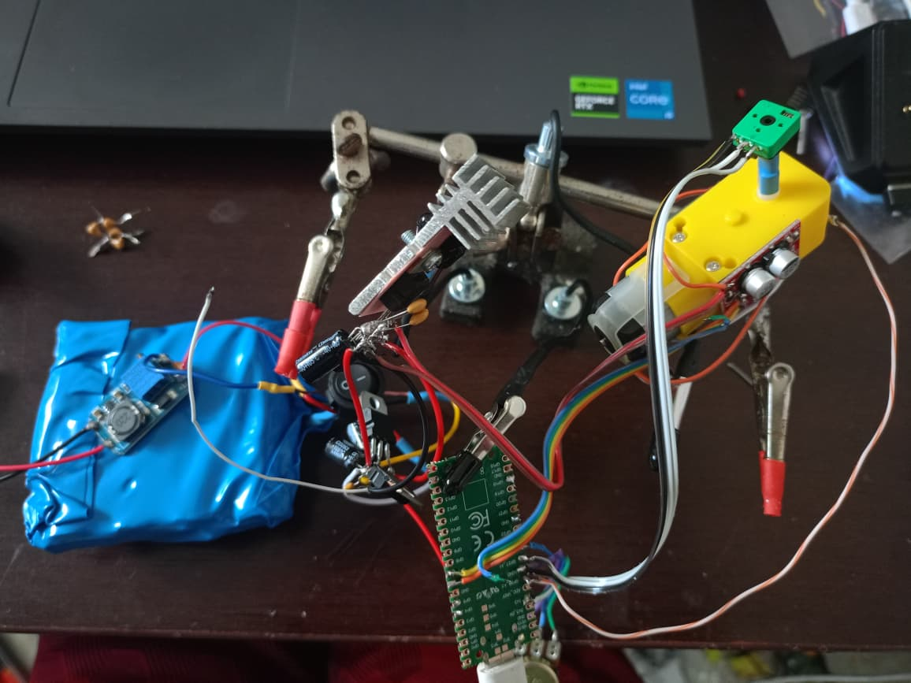
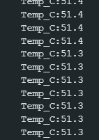

# Servo inteligente experimental com RP2040

Protótipo de baixo custo para o robô pato: motor DC TT com redutor, posição por potenciômetro, ponte MX1508, PID, medição ACS712 e temperatura por NTC. O objetivo é estudar um atuador acessível; arquitetura final, PCB e lote de 20 unidades continuam em avaliação.

## Resultado mais recente — ensaio de bancada em 7,5 V

O autor relatou **cinco minutos de teste extremo a 7,5 V**. As capturas mostram aquecimento da carcaça de 48,6 °C no início do trecho visível até **51,4 °C**, com leituras finais entre 51,3 e 51,4 °C. Esse intervalo não é o início completo do teste nem prova equilíbrio térmico.

[Relatório e limites da observação](docs/ensaio-termico-2026-10-31.md) · [Capturas originais](media/2026-10-31/ensaio-termico/)

É uma observação funcional de bancada, não validação de uso contínuo, torque ou tensão máxima. A leitura do NTC usa a curva configurada de 100k/B3950, ainda sem calibração independente. ACS_OK=1, mas ESCALA=0/Amp_OK=0: existe leitura em mV, **não corrente calibrada em amperes**. Não há CSV completo desse ensaio publicado.

## Firmware atual

Use a variante [V15 BANCADA-CARGA](firmware/atual/teste_tt_v15_bancada_carga/COMECE_AQUI.md). Ela mantém o PID ativo sob ausência de progresso, exibindo aviso em vez de travar o teste. Foi compilada; o usuário forneceu capturas de operação da família V15. As imagens não distinguem todas as variantes V15 porque compartilham o prefixo de telemetria.

1. Abra [teste_tt_v15_bancada_carga.ino](firmware/atual/teste_tt_v15_bancada_carga/teste_tt_v15_bancada_carga.ino), mantendo os seis arquivos .h juntos. Alvo de compilação: Raspberry Pi Pico, Arduino-Pico 6.0.0; confirme a variante física da sua placa.
2. Monitor Serial em **115200**. Saída inicial com colunas fixas, uma vez por segundo.
3. Com eixo aproximadamente no meio, envie **xz** e aguarde cerca de 1,2 s para medir o zero do ACS. Se souber a versão, selecione 1/2/3 para 5/20/30 A; sem identificação mantenha 0 e acompanhe mV.
4. **p**: B10K suave. **f**: B10K rápido, até 100% de PWM. **i**: vai e vem. **x**: parar.
5. **g**: Plotter PID. **h**: Plotter sensores. **l**: Monitor. **c**: coleta completa para o gravador. **?**: ajuda.

O ajuste V15 usa D=1,0 no f e D=1,8 no p/automático. Reduzir o D não certifica estabilidade para todas as tensões ou cargas. Os testes simulados e a evidência física estão separados em [Validação](docs/validacao.md).

**BANCADA-CARGA:** sem movimento, o PID continua podendo aplicar potência. SEM_MOV=1 e ESTADO=5 são avisos. Permanecem os cortes externos de posição, atraso do controle, parada por x e perda do Serial, além da verificação inicial de sentido. Não há corte por corrente ou temperatura. A V7 anteriormente publicada permanece no caminho antigo para preservar os links; é uma revisão anterior, não a versão atual.

## Ligações atuais

| Função | Ligação |
|---|---|
| CD74HC4067 VCC / GND / EN | 3V3 / GND / GND |
| MUX S0 / S1 / S2 / S3 | GP2 / GP3 / GP4 / GP5 |
| MUX SIG/COM | GP26 |
| C0 | Cursor B10K; extremos 3V3/GND |
| C1 | Junção do divisor: 3V3 → resistor fixo 4,7k → C1 → NTC 100k → GND |
| C2–C15 | Reservados; ainda não lidos |
| Potenciômetro acoplado ao TT | Cursor GP27; extremos 3V3/GND |
| ACS712 OUT | Divisor 10k/10k ao GP28; sensor alimentado em 5 V, GND comum |
| MX1508 IN1 / IN2 | GP6 / GP7 |
| Motor TT | Saída A da ponte |
| Servo normal opcional | Sinal GP18, fonte adequada e GND comum |

GP indica GPIO, não número físico do conector. A fonte do motor alimenta a ponte pelo caminho ACS IP+ → IP−; o retorno de potência vai à fonte, com GND comum ao RP2040. Não aplicar 5 V às entradas ADC ou aos canais do multiplexador. Nunca alimentar motor pelo 3V3.

O NTC está configurado conforme o programa da extrusora: 100k a 25 °C, Beta 3950, resistor fixo 4,7k. A inscrição de curso de 216° no potenciômetro foi informada pelo autor. O firmware assume ADC 0–4095 = 0–216°, com comando nominal de 18–198°; isso não demonstra 180° físicos calibrados.

## Gravação e análise

[Gravador de Testes V3 para Windows](tools/GravadorDeTestesV3/COMECE_AQUI.md): executável, código-fonte e prévia com dados fictícios. Reconhece V13/V14/V15, cria nomes por data/modo/versão e salva CSV, registro bruto e resumo. Feche o Monitor/Plotter antes de usar a mesma porta no gravador.

O gravador foi compilado e testado com dados sintéticos; isso é separado do teste físico do firmware feito pelo autor. Na coleta completa, ESTADO=5 registra o aviso de falta de progresso. As variantes V15 compartilham a identificação; consulte a pasta do sketch gravado para distinguir a variante.

## Histórico e próximos passos

- [Evolução dos testes](docs/testes-2026-10-31.md)
- [Códigos anteriores, incluindo tentativas que falharam](firmware/historico/)
- [Validação e testes reproduzíveis](docs/validacao.md)
- [Fotos da primeira montagem e capturas](media/2026-10-31/README.md)
- [Arquitetura e opções futuras](docs/arquitetura-e-proximos-passos.md)

Encoder magnético de 360°, DRV8876, comunicação entre atuadores, um controlador por servo versus controle centralizado e PCB para 20 unidades são opções futuras. O protótipo físico atual usa **MX1508**, não DRV8876. Ainda não foram definidos torque útil, precisão, vida útil, custo final ou licença de distribuição.
