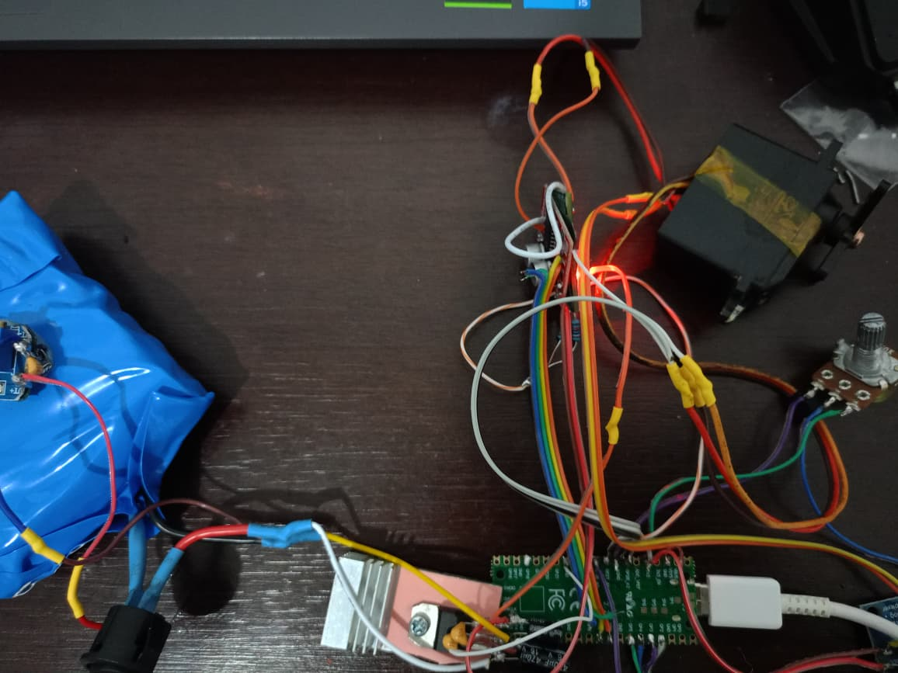
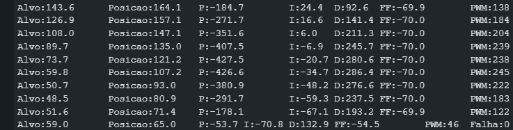

# Avanço de bancada — 01/11/2026

## Do motor TT ao servo convertido

O autor substituiu o conjunto motor TT por um servo **ST47 com o motor original**, usando o controle externo experimental, e relatou bons resultados no primeiro teste. A identificação como JR SPORT ST47 é compatível com a pesquisa feita durante a conversa, mas não foi confirmada por uma etiqueta legível nesta foto.

A imagem documenta o estado da montagem: placa RP2040 conectada por USB, fiação de bancada, potenciômetro externo e conjunto do servo. Não é um esquema elétrico nem comprovação de todas as conexões.

## V16: seleção de PID sem recompilar

Foi preparada a [V16 com perfis de PID](../firmware/atual/teste_servo_v16_perfis_pid/LEIA-ME.md), baseada na V15 BANCADA-CARGA. Um dígito de 0 a 9 no Serial seleciona combinações de Kp, Ki e Kd. O perfil 0 mantém os ganhos anteriores; k mostra os ganhos. Na troca, a memória integral é zerada e o observador de velocidade e a rampa de PWM são preservados. Reiniciar a placa restaura o perfil 0.

Os comandos p/f, Plotter g/h, parada x e a pinagem continuam disponíveis. A seleção da variante do ACS712 passou de 0–3 para a0–a3, evitando conflito com os perfis. O pacote de coleta continua D15/28 campos e não registra o número do perfil; o gravador antigo precisa que essa informação seja associada ao ensaio.

Compilação concluída para Raspberry Pi Pico com Arduino-Pico 6.0.0: 70.612 bytes de programa e 9.512 bytes de variáveis globais. O autor enviou anteriormente captura com identificação V16/PERFIL, confirmando execução da nova família no teste. Isso não valida estabilidade para todas as cargas e tensões.

## Evidência de controle e velocidade ainda em ajuste

A captura mostra alvo, posição, parcelas P/I/D/FF e PWM variando durante o movimento. Na linha final visível, Falha=0. Há valores de PWM até 245 neste trecho; a imagem isolada não comprova acionamento máximo sustentado. Os rótulos da captura não identificam o perfil, a versão do firmware ou a tensão deste ensaio.

O autor relata velocidade menor do que com o controle original do servo, mesmo no modo f. Também relata pouca diferença de velocidade entre os perfis, com os mais amortecidos ficando mais lentos principalmente no início e no fim. A causa da diferença de velocidade permanece aberta: não foi medida a tensão efetiva nos terminais do motor nem feita comparação quantitativa de tempo com a eletrônica original.

O modo p ainda limita a referência a 45 graus/s. O modo f permite PWM até ±255, mas o PID pode comandar valores menores. A escala continua herdada do teste anterior: ADC 0–4095 = 0–216 graus. O potenciômetro do servo convertido precisa de calibração própria antes de tratar ângulo e velocidade como medidas físicas precisas.

## Alimentação e limites do registro

A tensão efetivamente usada neste teste de ST47 não foi confirmada. Os 7,5 V e o ensaio térmico de 31/10 pertencem ao teste anterior com motor TT e não certificam o motor do ST47.

O [manual JR S400](https://www.greathobbies.com/manuals/j/jsp/s400_manual.pdf) apresenta o ST47 no sistema alimentado em 4,8 V. Um [projeto de laboratório que modifica o ST47](https://kunio00takaya.web.fc2.com/EE331design2008/ee331design_12.pdf) documenta acionamento de até 6 V. Não foi encontrada especificação do limite absoluto do motor interno; 6 V foi adotado apenas como limite conservador para continuar a investigação, não como validação de operação contínua.

Sem CSV completo deste ensaio, corrente calibrada, torque medido ou teste de duração. A base BANCADA-CARGA continua avisando sem cortar por ausência de progresso; não possui corte por corrente/temperatura.

## Arquitetura discutida, ainda não construída

Foi discutida a distribuição de três RP2040: um por perna (cinco motores cada) e um para pescoço/cabeça (quatro motores na configuração de 14). Também foram discutidos INA219, encoder I2C e retirada temporária do NTC. Esses itens são propostas; a V16 publicada mantém ACS712, potenciômetro e multiplexador da bancada anterior.

As duas imagens desta página são os arquivos originais enviados pelo autor. Não foi recebido vídeo com esta atualização.
