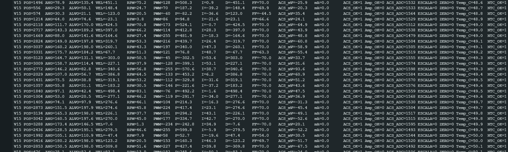
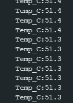

# Ensaio térmico de bancada — 31/10/2026

## Condições informadas pelo autor

- Protótipo TT, RP2040, MX1508 e potenciômetro de posição diretamente acoplado ao eixo de saída.
- Cinco minutos de teste descrito pelo autor como "extremo", simulando solicitações de movimento do robô.
- **Fonte do motor em 7,5 V**, confirmada pelo autor para este ensaio.
- NTC instalado na carcaça do motor, conforme relato; não houve inspeção independente da fixação.
- Firmware da família V15. O prefixo compartilhado não identifica sozinho se já era a variante BANCADA-CARGA.
- Carga/torque, perfil exato de comandos, ventilação, temperatura ambiente, temperatura inicial e tensão nos terminais do motor não foram medidos/documentados neste registro.
- Não foi confirmado se o motor continuava em movimento/sob carga no recorte final da temperatura.

## Evidências fornecidas

A captura mostra leituras visíveis a partir de 48,6 °C até cerca de 50,1 °C no trecho integralmente legível. Isso é um recorte do ensaio, não sua temperatura inicial. Há posição, alvo, velocidade, parcelas PID e PWM, inclusive comandos próximos do máximo. NTC_OK=1 indica plausibilidade elétrica do cálculo configurado, não calibração metrológica.

No recorte final, a **máxima visível é 51,4 °C**, seguida por valores de 51,3 °C. É a máxima das imagens entregues, não necessariamente a máxima de todos os cinco minutos. As capturas não têm marcação de tempo suficiente para reconstruir uma curva térmica completa.

A curva NTC é **100k a 25 °C / Beta 3950**, resistor fixo 4,7k, baseada no programa da extrusora. Um resistor desconectado foi encontrado e reconectado antes deste registro. Não houve comparação publicada com um termômetro de referência. As temperaturas são estimativas dessa montagem.

## Corrente e desempenho

A telemetria mostra **ACS_OK=1, ESCALA=0, Amp_OK=0**. Assim, ACS_mV é uma variação disponível, mas mA=0 é um marcador de corrente indisponível. Não se pode inferir consumo nulo, potência elétrica, torque, eficiência ou carga RMS a partir disso. A leitura do ACS é da alimentação da ponte, diferente de toda a corrente recirculante no motor sob PWM/frenagem.

Não foi enviado CSV integral para esse ensaio. Os números de RPM/graus dependem da hipótese de curso linear de 216°. O teste não mede torque e não comprova precisão angular, estabilidade em todos os movimentos ou vida útil.

## Interpretação

O registro é um avanço útil: o protótipo funcionou sob solicitações de bancada e há acompanhamento de aquecimento da carcaça. **51,4 °C na superfície após esse ensaio curto não define uma temperatura máxima permitida nem confirma uso contínuo a 7,5 V.** O trecho final varia pouco, mas faltam duração e condição de carga para classificá-lo como equilíbrio térmico.

A temperatura do enrolamento pode diferir da carcaça. Modelos térmicos de motores distinguem enrolamento, carcaça e ambiente; a relação depende da dissipação e do regime. Não há parâmetro térmico do TT específico identificado para converter essa leitura em temperatura interna. [Nidec — resistência térmica](https://www.nidec.com/en/products/small-precision-motors/technology/motor/glossary/item/thermal_resistance/)

O TT Adafruit 3777 é especificado para 3–6 V, enquanto existem outras versões TT com faixas diferentes. Esse é um exemplo de fabricante, não identificação do exemplar deste projeto. O ensaio em 7,5 V registra uma condição experimental, sem homologá-la para o motor desconhecido. [Adafruit 3777](https://www.adafruit.com/product/3777)

## Próximas medições úteis

Registrar o CSV completo com tempo; identificar o motor e a variante ACS; conferir temperatura com referência; comparar a mesma montagem/carga em tensões conhecidas; acompanhar o aquecimento enquanto a carga continua e documentar o resfriamento separadamente. Manter firmware e condição de ensaio identificados. As novas capturas foram preservadas sem reconstruir dados que não foram fornecidos.
