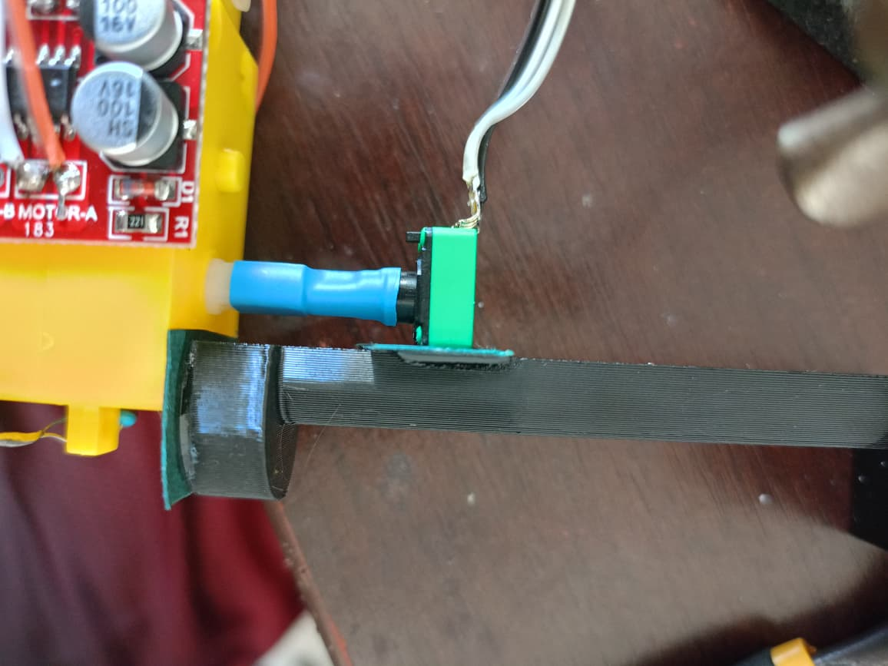
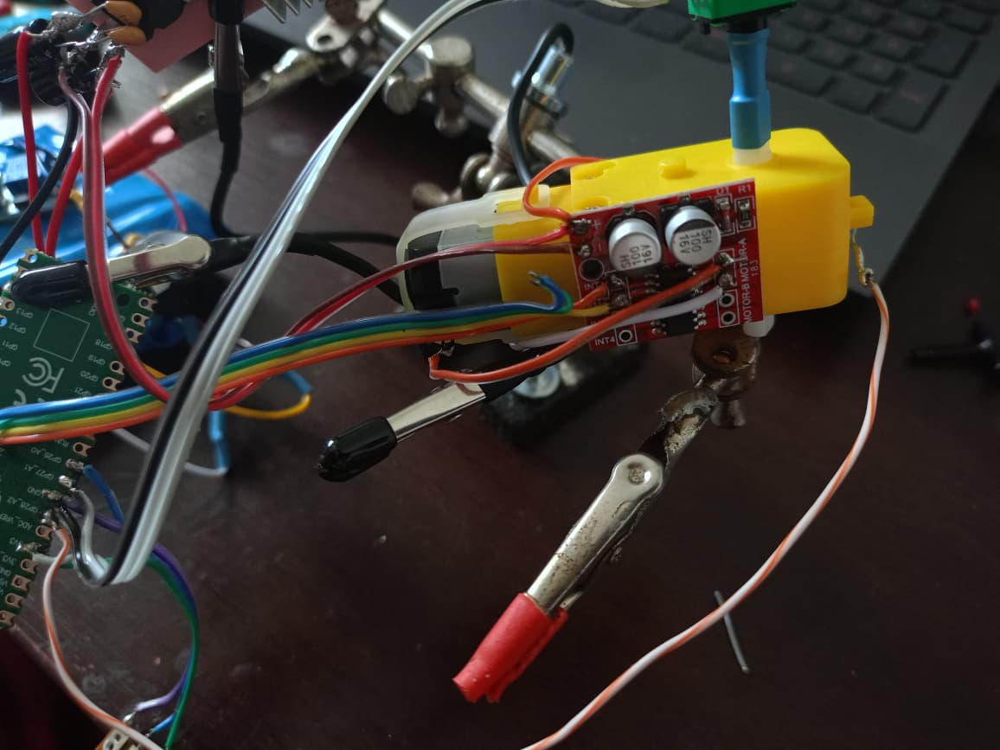
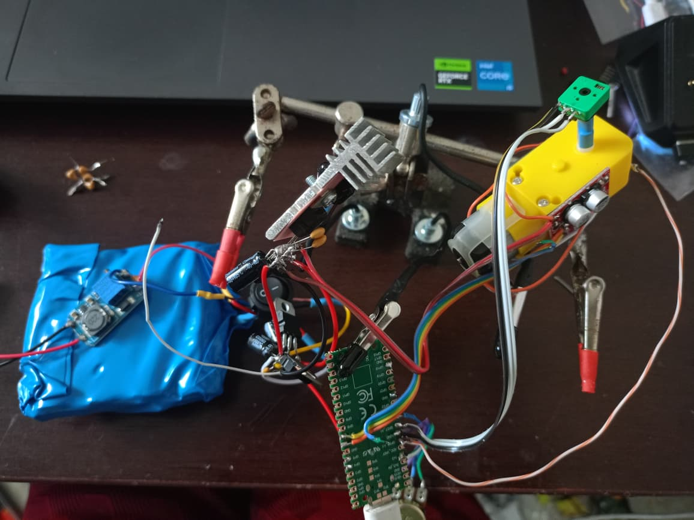

# Primeiro teste experimental

Fotos fornecidas pelo autor em um ZIP de WhatsApp. Preservadas como recebidas,
com nomes neutros para o repositório. Elas documentam a bancada e não provam
pinagem correta, desempenho ou validação do controle.

| Arquivo | Conteúdo visível |
|---|---|
| [foto_01.jpeg](foto_01.jpeg) | Acoplamento entre eixo do TT, peça azul e potenciômetro, junto ao suporte. |
| [foto_02.jpeg](foto_02.jpeg) | Outro ângulo do acoplamento e dos terminais do potenciômetro. |
| [foto_03.jpeg](foto_03.jpeg) | Módulo de corrente e resistores da montagem inicial. |
| [foto_04.jpeg](foto_04.jpeg) | Ponte sobre o motor TT e fios de ligação na bancada. |
| [foto_05.jpeg](foto_05.jpeg) | Visão geral com TT, RP2040, alimentação e apoios de bancada. |
| [serial_01_acs_saturado.png](serial_01_acs_saturado.png) | ACS em 4095 e bloqueio da calibração de zero. |
| [serial_02_acs_estavel_sem_movimento.png](serial_02_acs_estavel_sem_movimento.png) | Leitura de repouso plausível do ACS, posição estável e falha por falta de movimento. |
| [serial_03_v6_bloqueio_calibracao.png](serial_03_v6_bloqueio_calibracao.png) | V6 com B registrado, escala angular inválida e início bloqueado. |

## Ensaio térmico posterior

[Capturas originais do ensaio de cinco minutos a 7,5 V](ensaio-termico/README.md), com máxima visível de 51,4 °C. Consulte o relatório para as condições que ainda não foram confirmadas.
